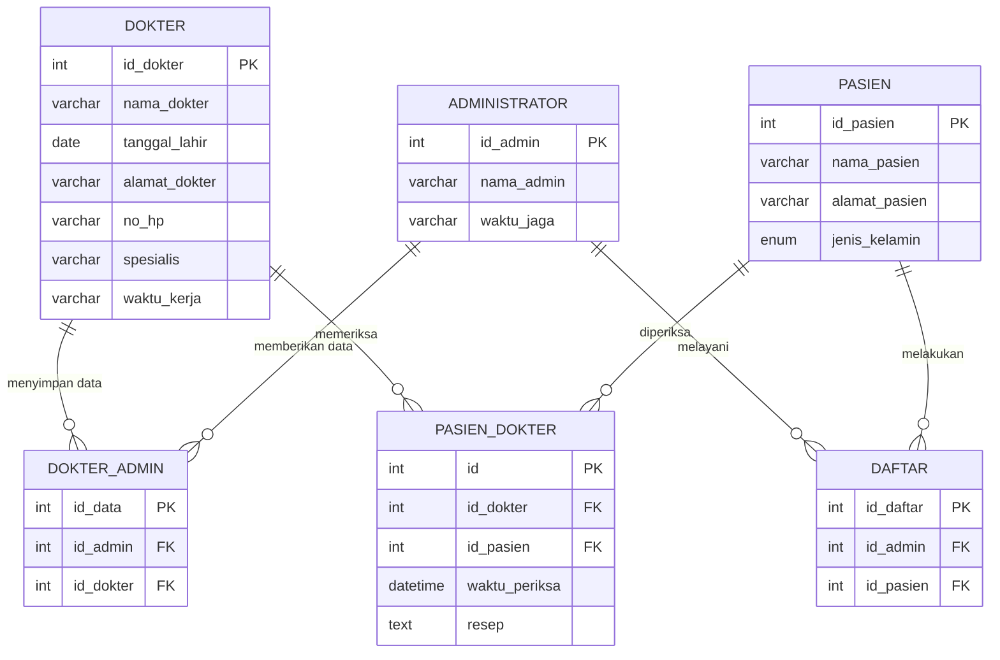

🇬🇧 [English](README.md)

# 🏥 Database Klinik (MySQL / MariaDB)

Basis data relasional untuk klinik kecil yang dibuat di **MySQL/MariaDB** (XAMPP) berdasarkan Entity Relationship Diagram. Basis data ini mengelola dokter, pasien, administrator, pendaftaran pasien, dan pemeriksaan, lengkap dengan kunci primer, kunci asing, data contoh, dan contoh query `JOIN`.

Dibuat sebagai tugas mata kuliah *Basis Data* di Universitas Terbuka.

## 🗺️ Entity Relationship Diagram



## 🗃️ Tabel

| Tabel | Fungsi |
|---|---|
| `dokter` | Data dokter: nama, tanggal lahir, alamat, no HP, spesialis, waktu kerja |
| `pasien` | Data pasien: nama, alamat, jenis kelamin (`L` atau `P`) |
| `administrator` | Petugas administrasi dan jadwal jaganya |
| `dokter_admin` | Penghubung administrator dan dokter (data diberikan dan disimpan) |
| `daftar` | Pendaftaran pasien yang dilayani administrator |
| `pasien_dokter` | Pemeriksaan: dokter, pasien, waktu periksa, dan resep |

Semua relasi berjenis satu-ke-banyak. Kunci asing memakai `ON UPDATE CASCADE` dan `ON DELETE RESTRICT`, sehingga dokter, pasien, atau administrator yang masih dipakai tabel lain tidak dapat dihapus.

## 📁 Struktur Proyek

```
.
├── tugas2_db_klinik.sql   # Database, tabel, data contoh, dan query pemeriksaan
├── README.md
└── README.id.md
```

## 🚀 Cara Menjalankan

**Prasyarat:** [XAMPP](https://www.apachefriends.org/) (atau server MySQL/MariaDB lain dengan phpMyAdmin).

1. Buka **XAMPP Control Panel**, lalu **Start** pada **Apache** dan **MySQL**.
2. Buka `http://localhost/phpmyadmin`.
3. Buka tab **Import**, pilih `tugas2_db_klinik.sql`, lalu klik **Import**.
   Cara lain: buka tab **SQL**, tempel isi file, lalu klik **Go**.
4. Pilih `db_klinik` di panel kiri untuk melihat enam tabel. Tab **Designer** menampilkan relasinya.

Atau lewat baris perintah:

```bash
mysql -u root -p < tugas2_db_klinik.sql
```

> Skrip membuat database `db_klinik` jika belum ada. Kalau dijalankan ulang, hapus dulu database yang sudah ada (tabel dibuat tanpa `IF NOT EXISTS`).

## 🔍 Contoh Query

Pemeriksaan beserta pasien, dokter, waktu, dan resep:

```sql
SELECT p.nama_pasien, d.nama_dokter, pd.waktu_periksa, pd.resep
FROM pasien_dokter pd
JOIN pasien p ON p.id_pasien = pd.id_pasien
JOIN dokter d ON d.id_dokter = pd.id_dokter
ORDER BY pd.waktu_periksa;
```

Pendaftaran pasien beserta administrator yang melayani:

```sql
SELECT p.nama_pasien, a.nama_admin
FROM daftar df
JOIN pasien p ON p.id_pasien = df.id_pasien
JOIN administrator a ON a.id_admin = df.id_admin;
```

## 🧠 Konsep yang Diterapkan

- Mengubah ERD menjadi tabel relasional
- Memilih tipe data yang sesuai (`VARCHAR`, `DATE`, `DATETIME`, `ENUM`, `TEXT`)
- Kunci primer dengan `AUTO_INCREMENT`
- Kunci asing dan integritas referensial (`CASCADE` / `RESTRICT`)
- Engine InnoDB yang mendukung kunci asing
- Mengisi data dengan urutan tabel induk lalu tabel anak
- Query `JOIN` beberapa tabel

## ⚠️ Catatan

- Semua data contoh (nama, alamat, nomor HP, resep) adalah **fiktif**.
- Waktu kerja dan jadwal jaga disimpan sebagai teks biasa agar sederhana.

## 👤 Penulis

**Lioniel Salomon Siregar** — Sistem Informasi, Universitas Terbuka

## 📄 Lisensi

Proyek ini dibuat untuk keperluan pembelajaran. Silakan gunakan dan kembangkan sesuai kebutuhan.
