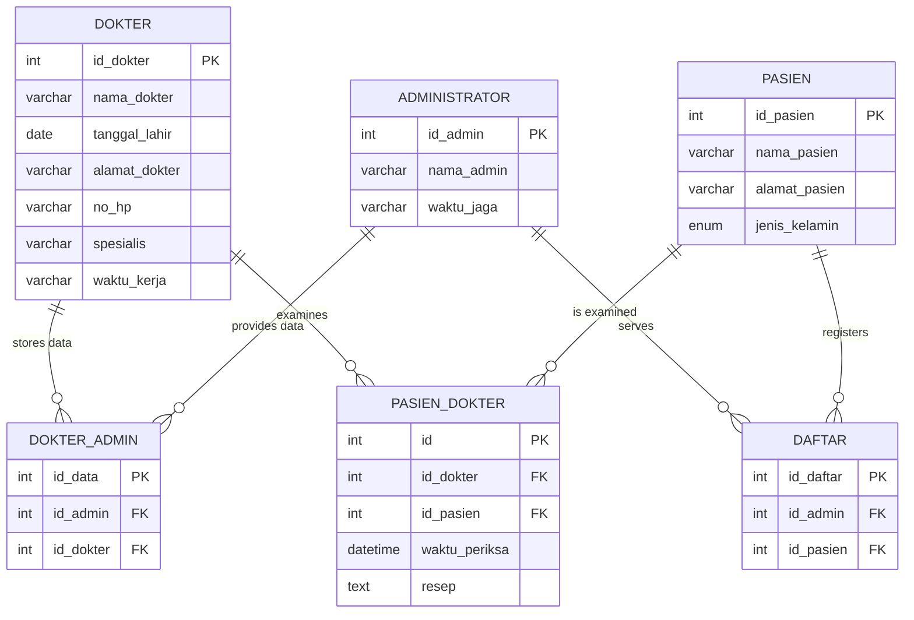

🇮🇩 [Bahasa Indonesia](README.id.md)

# 🏥 Clinic Database (MySQL / MariaDB)

A relational database for a small clinic, implemented in **MySQL/MariaDB** (XAMPP) from an Entity Relationship Diagram. It manages doctors, patients, administrators, patient registration, and medical examinations, with primary keys, foreign keys, sample data, and example `JOIN` queries.

Built as a *Database* course project at Universitas Terbuka. Table and column names are in Indonesian, matching the original assignment.

## 🗺️ Entity Relationship Diagram



## 🗃️ Tables

| Table | Purpose |
|---|---|
| `dokter` | Doctors: name, birth date, address, phone, specialty, working hours |
| `pasien` | Patients: name, address, gender (`L` or `P`) |
| `administrator` | Administrative staff and their duty shifts |
| `dokter_admin` | Links administrators and doctors (data provided and stored) |
| `daftar` | Patient registrations handled by an administrator |
| `pasien_dokter` | Examinations: doctor, patient, examination time, and prescription |

All relationships are one-to-many. Foreign keys use `ON UPDATE CASCADE` and `ON DELETE RESTRICT`, so a doctor, patient, or administrator that is still referenced cannot be deleted.

## 📁 Project Structure

```
.
├── tugas2_db_klinik.sql   # Database, tables, sample data, and check queries
├── README.md
└── README.id.md
```

## 🚀 Getting Started

**Requirements:** [XAMPP](https://www.apachefriends.org/) (or any MySQL/MariaDB server with phpMyAdmin).

1. Open **XAMPP Control Panel** and start **Apache** and **MySQL**.
2. Go to `http://localhost/phpmyadmin`.
3. Open the **Import** tab, choose `tugas2_db_klinik.sql`, and click **Import**.
   Alternatively, open the **SQL** tab, paste the file's contents, and click **Go**.
4. Select `db_klinik` in the left panel to see the six tables. The **Designer** tab shows the relationships.

Or from the command line:

```bash
mysql -u root -p < tugas2_db_klinik.sql
```

> The script creates the database `db_klinik` if it does not exist. If you re-run it, drop the existing database first (the tables are created without `IF NOT EXISTS`).

## 🔍 Example Queries

Examinations with patient, doctor, time, and prescription:

```sql
SELECT p.nama_pasien, d.nama_dokter, pd.waktu_periksa, pd.resep
FROM pasien_dokter pd
JOIN pasien p ON p.id_pasien = pd.id_pasien
JOIN dokter d ON d.id_dokter = pd.id_dokter
ORDER BY pd.waktu_periksa;
```

Patient registrations with the administrator who served them:

```sql
SELECT p.nama_pasien, a.nama_admin
FROM daftar df
JOIN pasien p ON p.id_pasien = df.id_pasien
JOIN administrator a ON a.id_admin = df.id_admin;
```

## 🧠 Concepts Applied

- Translating an ERD into relational tables
- Choosing suitable data types (`VARCHAR`, `DATE`, `DATETIME`, `ENUM`, `TEXT`)
- Primary keys with `AUTO_INCREMENT`
- Foreign keys and referential integrity (`CASCADE` / `RESTRICT`)
- The InnoDB engine, which supports foreign keys
- Inserting data in parent-then-child order
- Multi-table `JOIN` queries

## ⚠️ Notes

- All sample data (names, addresses, phone numbers, prescriptions) is **fictional**.
- Working hours and duty shifts are stored as plain text for simplicity.

## 👤 Author

**[Your Name]** — [Student ID] — Information Systems, Universitas Terbuka

## 📄 License

Created for learning purposes. Feel free to use and extend it.
